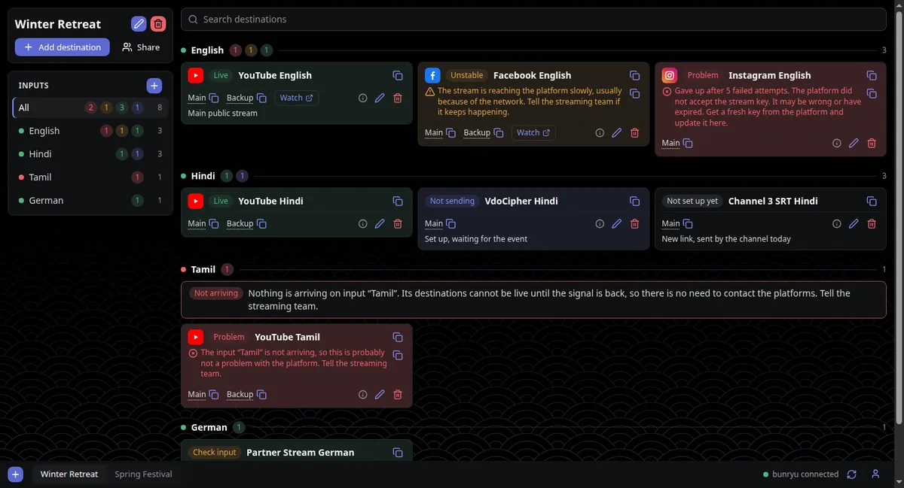
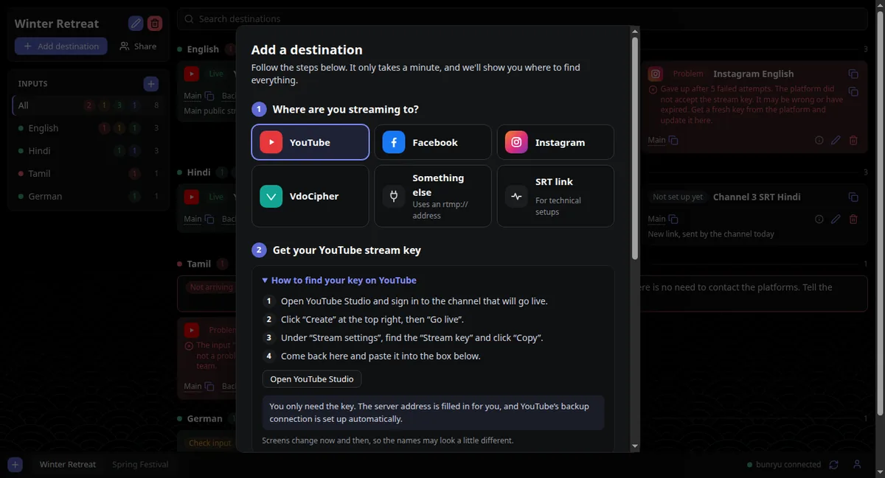

# Key Vault

[](https://github.com/live-miracles/key-vault/actions/workflows/deploy.yml)

**Add every stream destination for a live event, and see in plain words whether each one is working.**

Key Vault is a web app for media teams who send a live stream to many places at once: YouTube,
Facebook, Instagram, TV channels and other third parties. It replaces the shared spreadsheet of stream
keys with a guided form that stops wrong links, and it shows the live status of every destination, so
nobody has to ask "is it going out?" in a chat.



## Why it exists

Stream keys used to travel in a Google Sheet. Then a key went into the address box (or the other way
round), the backup column held the main link, and nobody knew a link was wrong until the stream failed
on air. When a channel said it was not receiving anything, the media team could not see which output
was down, or why.

- **Wrong links cannot be saved.** The form asks only for what each platform needs, cuts a pasted full
  address down to the key, and checks the result. The server checks again, so nothing that skips the
  form can store a bad link.
- **Every destination shows its real state.** The streaming server, [bunryu](https://github.com/live-miracles/bunryu),
  reports each output once a minute. A card shows **Live**, **Unstable**, **Problem**, **Not sending** or
  **Not set up yet**. Nobody sets a colour by hand.
- **It says what to try.** A red card says, in plain words, what is probably wrong ("The platform did
  not accept the stream key. Get a fresh key from the platform and update it here.") and who to tell.
  When the input is not arriving, it says so, and nobody wastes time chasing the platform.
- **Changes are visible.** A replaced link stays **Not set up yet** until the streaming server has it,
  and each card records who last changed it and when.
- **Access follows the work.** People are owners, admins, editors or viewers, and editors and viewers
  can be limited to a single input, such as one language. The server decides what each person may do.
- **Installs like an app.** Chrome, Edge and phones can add it to the desktop or home screen.

## Try it

Run the demo on your own machine. It uses made-up events and statuses, so it needs no account:

```bash
git clone https://github.com/live-miracles/key-vault.git
cd key-vault
npm install
npm run dev        # http://localhost:2837
```

Use **Add destination** to see the guided form. Everything the demo does runs the same operations as
the real server.



## Install it as an app

Open the site in Chrome or Edge and click the install icon in the address bar. Key Vault then opens in
its own window, with its own icon, like any other app. Phones can use **Install app** or **Add to Home
Screen**. See [Install Key Vault as an app](docs/2-install-as-app.md). It always shows live data, so it
is not an offline tool.

## Documentation

| If you...                               | Read                                                |
| --------------------------------------- | --------------------------------------------------- |
| add destinations and check their status | [User guide](docs/1-user-guide.md)                  |
| run Key Vault for your team             | [Setting up Key Vault](docs/3-setup.md)             |
| connect a bunryu server                 | [The bunryu link](docs/5-bunryu-contract.md)        |
| change the code                         | [Development](docs/4-development.md)                |
| want the background and the terms       | [CONTEXT.md](CONTEXT.md) and [DESIGN.md](DESIGN.md) |

The same pages are published with the other Live Miracles projects at
[live-miracles.github.io/projects/key-vault](https://live-miracles.github.io/projects/key-vault/).

## How it fits together

```text
Browser → Vercel static site → Supabase Auth (Google)
                            └→ Edge Function `api` → Postgres
bunryu ──every minute──► Edge Function `ingest` → Postgres
```

The browser never reads the database directly: every table has row-level security with no policy.
Every call goes to the `api` function, which decides what the signed-in user may do, checks the
destination against the platform rules (the same module the form uses) and only then uses the service
role. The data it returns says what the user may do with each item, so the screens hold no rules of
their own.

bunryu sends a hash of each destination address, never the address. Key Vault hashes its own main and
backup addresses and matches them, so a destination shows as running, warning, error or
configured-but-stopped without anyone setting a colour. Stream keys never go to bunryu's heartbeat or
into a URL. The details are in [The bunryu link](docs/5-bunryu-contract.md).

It runs on **Vercel** (the site) and **Supabase** (sign-in, database and two Edge Functions), and fits
their free plans.

## Roles

- **Owner**: can edit or delete events and assign event admins. An owner anywhere is an owner everywhere.
- **Admin**: manages an event's inputs and can add viewers, editors and other admins.
- **Editor**: can add and edit destinations, and can be limited to one input.
- **Viewer**: can only view destinations, and can be limited to one input.

Anyone listed in `KEY_VAULT_OWNER_EMAILS` is an owner without a role.

## Part of Live Miracles

Key Vault is one of the tools the Live Miracles team builds to run large live events, alongside
[bunryu](https://github.com/live-miracles/bunryu) (the restreaming server it reports on),
[Live Gallery](https://github.com/live-miracles/live-gallery) and
[vMix Master](https://github.com/live-miracles/vmix-master). See all of them at
[live-miracles.github.io](https://live-miracles.github.io/).

## Contributing and license

Issues and ideas are welcome in [GitHub Issues](https://github.com/live-miracles/key-vault/issues). See
[Development](docs/4-development.md) to run the checks. Released under the [MIT License](LICENSE).
