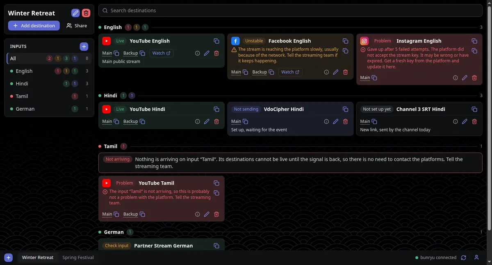
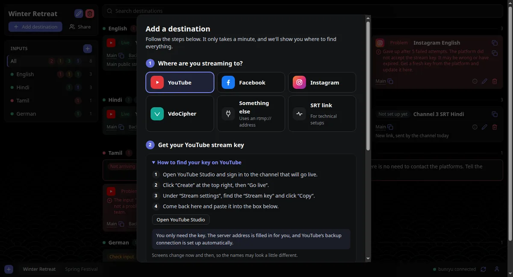

# User guide

For the media team: how to add a stream destination and tell whether it is working. You do not need to know anything technical, and you never have to guess what a colour means. Whoever runs Key Vault for your team gives you access with your Google account.

## What you see

- **An event** is one occasion being streamed. Switch between events with the tabs along the bottom.
- **Inputs** (on the left) are the feeds of that event, such as English or Hindi. Click one to see only its destinations, or click **All**. A dot beside each says whether its signal is arriving.
- **Destinations** are the cards: every place an input goes live, such as a YouTube channel, a Facebook page or a TV channel. On each card, a dot before **Main** and before **Backup** says whether that stream is on: green is live, yellow is unstable, red is a problem, and grey is off or not started yet. Hover a dot for the words. A destination with no backup has no backup dot, and while bunryu is not reporting there are no dots.
- **Search** at the top finds a destination by name, input, platform or note. Paste a stream key into it to find who is using that key.
- **Dark or light.** Key Vault opens dark. The sun or moon button at the bottom right switches to light (handy in a bright room) and back. It remembers your choice on that device.

## Add a destination

Click **Add destination**. A short form walks you through four steps.

1. **Where are you streaming to?** Pick YouTube, Facebook, Instagram or VdoCipher. Use **Something else** for a channel that gave you an `rtmp://` address, and **SRT link** for a link that starts with `srt://`.
2. **Get your stream key.** Open the short guide for that platform, copy the key from the platform and click **Paste**. If you paste a whole address by mistake, Key Vault cuts it down to the key for you. If the key looks wrong, the form says what to fix before you can save.
3. **Name this stream.** Choose the input it belongs to and give it a name you will recognise, such as "YouTube Hindi". Add the watch link and any notes, such as "new link sent by the channel today".
4. **Backup** (optional). Facebook asks for a second key. YouTube sets its backup up by itself and Instagram has none, so those boxes stay out of your way.

Saving stores the destination for the streaming team, who set it up on their server. Until they do, the card says **Not set up yet**. Once they have, it shows whether the stream is live.

## Change or replace a link

During an event a channel often sends a new link. Open the card, click the pencil, paste the new key and save. Then watch the card:

- **Not set up yet**, or the old status, means the streaming server does not have the new link yet. Tell the streaming team that the link has changed.
- Once the streaming team has put the new link on the server, the card shows its real state within a minute or two. That is how you know the update arrived.

Hover the small **i** on a card to see who last changed it and when.

## What the labels mean

The colour and the label come from the streaming server itself. Nobody sets them by hand.

| Label              | Colour | What it means                                              | What to do                                                           |
| ------------------ | ------ | ---------------------------------------------------------- | -------------------------------------------------------------------- |
| **Live**           | Green  | The stream is reaching the destination.                    | Nothing.                                                             |
| **Unstable**       | Amber  | It is sending, but not smoothly.                           | Tell the streaming team if it keeps happening.                       |
| **Problem**        | Red    | Nothing is getting through.                                | Read the line on the card. It says what to check first.              |
| **Not sending**    | Indigo | The link is set up, but nothing is being sent right now.   | Nothing, unless the event has started. Then tell the streaming team. |
| **Not set up yet** | Grey   | The streaming server does not have this link.              | Tell the streaming team, unless they have not set it up yet.         |
| **Check input**    | Amber  | The link is running under a different input than its card. | Open the card and pick the input it belongs to.                      |

When the whole page shows no colours, the streaming server is simply off. It only runs during events, so that is normal and not a fault.

### When an input is not arriving

If a red card sits under a banner that says **Nothing is arriving on input "…"**, the platform is not the problem. No signal is coming in, so none of that input's destinations can be live. There is no need to contact the platforms or the channel: tell the streaming team.

### When a card is red

A red card says in plain words what is probably wrong. The usual ones:

- **The platform did not accept the stream key.** The key is wrong or has expired. Get a fresh one from the platform and edit the card.
- **Could not reach the platform.** Check the address and key you entered, and that the stream is started on the platform.
- **The SRT link was rejected.** Check the link, with its passphrase and stream id, with whoever gave it to you.

Beside a red card there is a small copy button. It copies the technical details so you can paste them to the streaming team, who read them. You never need to read them yourself.

## Who can do what

| Role       | Can                                                                                                                                                      |
| ---------- | -------------------------------------------------------------------------------------------------------------------------------------------------------- |
| **Viewer** | See destinations and their status. Can be limited to one input.                                                                                          |
| **Editor** | Add, edit and delete destinations. Can be limited to one input.                                                                                          |
| **Admin**  | Everything an editor can, and create events, rename or delete their events, and manage their inputs. Add, change and remove editors, viewers and admins. |
| **Owner**  | Everything, in every event, including adding, changing and removing owners.                                                                              |

If a button you expect is missing, you do not have that role for this event: ask an admin to change it under **Share**.

## Keep it on your desktop or phone

Chrome and Edge can install Key Vault as an app with its own window and icon. See [Install Key Vault as an app](2-install-as-app.md).

## A safe habit

A stream key is like a password to your channel. Key Vault only shows keys to people with access to the event, and never sends one in a link. Do not paste a key into chat or email: add it here instead.
